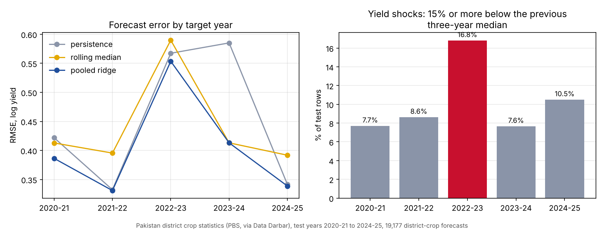

# HarvestGuard-PK

**Leakage-safe district-crop yield shock forecasting and uncertainty benchmark for Pakistan**

[](https://doi.org/10.5281/zenodo.24138382)

> The bundled CSV `data/synthetic_crop_panel.csv` is synthetic and only for tests. All results below come from the PBS-derived panel downloaded by `fetch-pbs`.

## Research objective

Test whether a pooled, lag-only ridge model can improve one-fiscal-year-ahead crop-yield forecasts over persistence and rolling-median baselines, and whether a calibration-period conformal interval provides useful uncertainty information when evaluating district–crop panels under a strictly forward-in-time split.

The target application is agricultural production risk and food-security planning. This is **not** a commodity-price forecasting project: it models physical crop yield (tonnes/hectare), not retail or wholesale prices.

## Why Pakistan

The Pakistan Bureau of Statistics (PBS) National Accounts crop dashboard describes district-level production, cultivated area and yield for 121 crops. A machine-readable secondary release built from that PBS portal provides 78,425 district–crop–fiscal-year rows for 108 crops, 123 districts and 44 fiscal years (1981–82 to 2024–25). Its catalogue documents coverage gaps and the source pull date; users must retain those caveats when interpreting results.

Pakistan-specific research has also documented relationships between temperature/rainfall variability and cereal productivity, including different responses across agro-ecological zones. Existing wheat-only forecasting literature makes a broad multi-crop, district-panel benchmark a useful complementary question rather than a claim that crop-yield forecasting itself is novel.

## Research questions

1. **RQ1 — Forecast skill:** Does pooled ridge regression reduce out-of-time log-yield RMSE relative to last-observation persistence and the median of the last three observed yields?
2. **RQ2 — Uncertainty:** Does a split-conformal interval calibrated on 2016–2019 achieve empirical 90% coverage on 2020–2024 test targets, and at what interval width?
3. **RQ3 — Shock alerts:** How precisely and sensitively can a forecast flag a yield shock, defined prospectively as a target yield at least 15% below the median of the previous three observed yields?

These are hypotheses to test, not pre-asserted findings.

## Design

- Every predictor for target fiscal year *t* comes from observations with fiscal year < *t*; all rows of a year are featurised before any of them enter the history.
- One pooled model over district x crop panels for all crops, not wheat only.
- Forward split by target year: train up to 2015, calibrate 2016 to 2019, test 2020 to 2024. The test years are not used for fitting or calibration.
- Forecasters: persistence (last observed yield), median of the last three yields, and a pooled ridge regression on nine lagged features (standard library only).
- Uncertainty: split-conformal interval on log yield (nominal 90%), and a bootstrap over district-crop groups for the ridge minus rolling-median RMSE difference.
- Shock alerts: a shock is a yield at least 15% below the median of the previous three yields; ridge and persistence alerts are scored with precision, recall and F1.

Details: [`docs/METHODOLOGY.md`](docs/METHODOLOGY.md), protocol in [`docs/EXPERIMENT_PROTOCOL.json`](docs/EXPERIMENT_PROTOCOL.json), fields in [`docs/DATA_DICTIONARY.md`](docs/DATA_DICTIONARY.md).

## Run it (Python 3.9+)

```bash
python3 -m venv .venv && source .venv/bin/activate
pip install -r requirements.txt && pip install -e .
python -m pytest -q
python -m harvestguard_pk.cli fetch-pbs --output data/pbs_crop_panel.csv
python -m harvestguard_pk.cli run --input data/pbs_crop_panel.csv --output-dir outputs/pbs --alpha 0.10
python -m harvestguard_pk.cli report --run-dir outputs/pbs
```

`fetch-pbs` downloads the Data Darbar Parquet extract of PBS crop statistics, converts it with DuckDB, validates it and writes `data/pbs_crop_panel.provenance.json` (URL, retrieval time, SHA-256, row counts). If the upstream schema changes, it stops and lists the columns it found. Rows with missing values or unlabelled crops are skipped; missing district-years are never filled with zero.

`run` writes `metrics.json`, `test_predictions.csv` and `run_metadata.json`; `report` adds `report.md`, `report.json` and `figures/rmse_by_year.png`, `figures/rmse_by_crop.png`.

Synthetic smoke run (no download): `sh examples/run_synthetic.sh`. Its numbers say nothing about Pakistan.

## Results (PBS-derived panel, run on 10 November 2026)

Data: `crops_district_fy.parquet` from Data Darbar, retrieved 2026-11-10 16:19 UTC, SHA-256 `ea13fc2a7c4d7b79e0f96a9964bfec25982f40f6cef75b9ed34768189e44cddd`. After filtering: 74,803 valid rows, 122 districts, 105 crop labels, fiscal years 1981-82 to 2024-25 ([`data/pbs_crop_panel.provenance.json`](data/pbs_crop_panel.provenance.json)). Forecast examples: train 20,371, calibration 17,095, test 19,177.

| Forecaster | RMSE (log yield) | MAE (log yield) |
|---|---|---|
| Persistence (last year) | 0.4639 | **0.2001** |
| Rolling median (3 years) | 0.4483 | 0.2166 |
| Pooled ridge | **0.4136** | 0.2093 |

- Ridge minus rolling-median RMSE: 95% group-bootstrap CI -0.0432 to -0.0267, so ridge has the lowest RMSE. Persistence has the lowest MAE: ridge mainly reduces the large misses.
- **Conformal interval under-covers:** nominal 90%, empirical test coverage 74.6% (mean width 0.477 on the log scale). The calibration years (2016-2019) did not represent the test years.
- **Yield shocks** (15% or more below the previous three-year median) were 10.4% of test rows. Persistence alerts: precision 0.392, recall 0.255, F1 0.309. Ridge alerts: precision 0.338, recall 0.138, F1 0.195.
- By target year, the shock rate was 16.8% in 2022-23 against 7.6% to 10.5% in the other test years, and every forecaster had its highest or second-highest error that year. In 2023-24 persistence carried the bad year forward (RMSE 0.585 against 0.413 for ridge and rolling median).

Per-crop and per-year tables: [`outputs/pbs/report.md`](outputs/pbs/report.md). Full metrics: [`outputs/pbs/metrics.json`](outputs/pbs/metrics.json).



### Coverage under temporal shift (paper analysis)

On the cleaned panel (70,225 rows, 98 crops; aggregate labels removed, one case duplicate merged), nominal 90% intervals cover 0.751 of 17,896 test yields (95% CI 0.741 to 0.760). Coverage is already 0.718 in 2020-21, and is 0.600 in Punjab and 0.658 in Balochistan against 0.950 in Sindh. Rolling four-year recalibration gives 0.839 with nearly double the width; adaptive conformal (gamma 0.5) gives 0.884 with very wide intervals in some years. Exploratory province-wise rolling calibration gives 0.849 with narrower intervals than pooled rolling. Reports: [`outputs/pbs_shift/shift_report.md`](outputs/pbs_shift/shift_report.md), [`outputs/pbs_diagnose/diagnose_report.md`](outputs/pbs_diagnose/diagnose_report.md). Paper: [`paper/main.pdf`](paper/main.pdf), preprint DOI [10.5281/zenodo.24138899](https://doi.org/10.5281/zenodo.24138899).

**Known data issues in this run** (to be fixed before any paper): crop labels differ only by case in one pair ("Potato" and "potato"), and some labels are aggregates ("Fodders Total", "Other Rabi Vegetables") pooled with single crops. Dates and grapes have unusually large errors (RMSE above 1.1 for every forecaster), which may come from reporting or unit changes.

Write-up: [Pakistan crop yield forecasts were 90% sure and right 75% of the time](https://masmatixinnovations.co.uk/insights/pakistan-crop-yield-forecast-intervals.html).

## Limitations

See [`docs/LIMITATIONS.md`](docs/LIMITATIONS.md): coverage gaps (for example AJK and GB districts are absent from the extract), district boundary and code changes over four decades, yield as an administrative aggregate, distribution shift between periods, one pooled model across very different crops, an operational shock threshold, and no weather or remote-sensing inputs.

## Repository

```text
src/harvestguard_pk/   data, features, model, metrics, experiment, report, cli
tests/                 unit and end-to-end tests (no network)
data/                  synthetic test panel and notices
docs/                  methodology, protocol, data dictionary, sources, limitations
examples/              synthetic smoke run
```

## Licensing

- **Code:** MIT License (`LICENSE`).
- **PBS aggregate source data:** follow the current PBS Official Statistics & Data Dissemination Policy and its attribution requirements. The Data Darbar catalogue also labels its derived data CC BY 4.0; cite the PBS original and the Data Darbar packaging, mark modifications, and do not imply derived estimates are official PBS statistics. Check the upstream catalogue and policy at redistribution time.
- **Synthetic panel:** generated by this repository, not official observations; use under the repository's MIT code licence.

## Responsible interpretation

The model estimates district–crop yield from historical statistical panels. It does not identify causal climate effects, provide farm-level advice, forecast market prices, or replace crop-cutting surveys and agronomic expertise. Reporting/measurement changes, administrative boundary changes, crop definitions and missing geographies can bias results. Read `docs/LIMITATIONS.md` before interpreting or publishing results.

## Citation

Paper (preprint): Hussain, M. (2026). *When 90% Means 75%: Conformal Crop Yield Intervals for Pakistan's Districts under Temporal Shift*. Zenodo. https://doi.org/10.5281/zenodo.24138899. Software release v0.3.1 is archived on Zenodo: https://doi.org/10.5281/zenodo.24138382. See `CITATION.cff`. Cite PBS as the original statistical source and the Data Darbar extract as the machine-readable packaging when using that extract. Cite the specific release and retrieval date in any resulting paper or dataset card.
